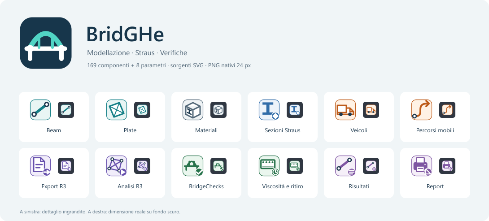

# Icone BridGHe

Sistema grafico originale per il plugin, i 169 componenti e gli 8 parametri Grasshopper. Le icone sono risorse incorporate nel `.gha`: non richiedono file esterni durante l'uso. Il catalogo segue i componenti effettivamente registrati.



## Convenzioni

| Famiglia | Colore | Simboli |
|---|---|---|
| Modello | Petrolio | Nodi, beam, plate e assemblaggio |
| Sezioni | Blu | Sagoma della sezione; contrassegni per Straus e BGL |
| Materiali | Grigio blu | Materiali e proprietà |
| Carichi e carichi mobili | Arancio | Forze, momenti, veicoli, percorsi e template |
| Straus | Viola | Esportazione, analisi e fasi |
| Verifiche ponti | Verde | Controlli ed effetti nel tempo |
| Risultati | Viola chiaro | Elemento e dati estratti |

La sagoma e i contrassegni distinguono le funzioni anche senza affidarsi al solo colore. Ogni componente/parametro ha un asset distinto. I parametri hanno fondo bianco e un piccolo contrassegno dedicato. I simboli delle sezioni descrivono la tipologia, non la geometria corrente del modello.

Il logo rappresenta un ponte ad arco con impalcato, appoggi e nodi. È disponibile anche a 512×512 px. Componenti e identità del plugin usano PNG **24×24 px**; la sola categoria `BridGHe` usa **16×16 px**, secondo l'API Grasshopper.

## File e rigenerazione

- `assets/icons/`: sorgenti SVG modificabili, logo, anteprima e [catalogo completo](../assets/icons/catalogue.png).
- `assets/icons/manifest.json`: associazione tra tipo .NET, GUID, famiglia, simbolo e contrassegno.
- `src/BridGHe.Grasshopper/Resources/Icons/`: 179 PNG incorporati (177 componenti/parametri, marchio a 24 px e categoria a 16 px).
- `assets/icons/replaced-legacy-assets.json`: elenco delle 94 vecchie icone sostituite. Gli schemi illustrativi ancora usati nei menu restano nel progetto.

Per cambiare il sistema grafico in modo riproducibile, modificare `tools/generate_icons.py` e rigenerare dalla radice del repository. Richiede Python 3 e Node.js con il pacchetto `sharp` disponibile:

```powershell
py tools/generate_icons.py
node tools/render_icons.cjs
.\tools\build.ps1 -Smoke -Package
```

Se `sharp` è installato in un ambiente condiviso, impostare `NODE_PATH` alla sua cartella `node_modules`. I PNG generati sono parte del progetto: la normale compilazione del plugin non richiede Node.js o un motore SVG. Una modifica manuale a un SVG viene conservata dal renderer, ma viene sovrascritta eseguendo nuovamente il generatore Python.

Il caricamento usa una cache condivisa e segnala una risorsa mancante. Il controllo nel runtime Rhino 8 verifica copertura, dimensioni, associazione degli asset e registrazione delle categorie. Le anteprime mostrano anche il simbolo a 24 px su fondo scuro.
