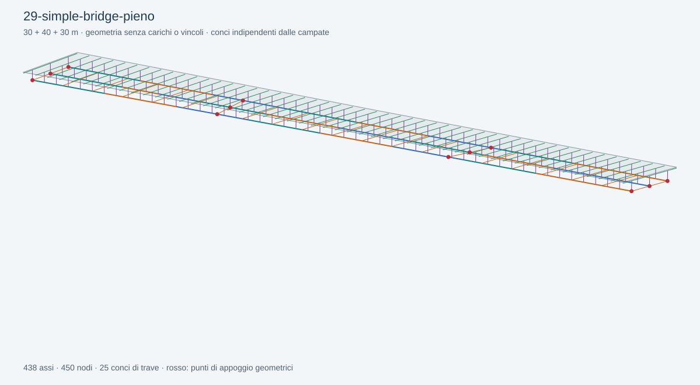

# 29 — Simple Bridge, traversi pieni, rettilineo

Aprire [29-simple-bridge-pieno.ghx](29-simple-bridge-pieno.ghx) con la nuova Release di BridGHe in Rhino 8. Il file genera direttamente la geometria, senza Straus.

Campate 30+40+30 m, tre travi a −4/0/+4 m, soletta larga 12 m e spessa 250 mm. Tutti gli input sono in mm. La pendenza trasversale varia da −2% a +2% e poi +3%; gli appoggi interni hanno sghembo +12° e −8°.

Prove guidate:

1. Portare `Labels` a true: identificare appoggi e giunti.
2. Leggere `Segment Ranges`: il concio 24–36 m attraversa la pila a 30 m.
3. Aprire la raccolta persistente del parametro «Giunti mm»: il ramo `{0}` contiene i giunti comuni, `{2}` aggiunge il giunto a 18 m solo su G2.
4. Modificare il pannello del passo traversi da 5000 a 4000 mm: aumenta il numero di traversi, senza cambiare i giunti assegnati.
5. Modificare la lunghezza massima da 2500 a 1250 mm: aumenta la discretizzazione longitudinale, senza cambiare il numero dei conci.

Gli assi non hanno sezioni o proprietà meccaniche. I punti degli appoggi non sono vincoli. Per i collegamenti successivi a `Beam`, `Element ID` e `Build Model`, consultare la [guida Simple Bridge](../../docs/SIMPLE-BRIDGE.md).

[Report di soluzione e riapertura](validation.json). La preview SVG deriva dalle coordinate effettivamente generate.
