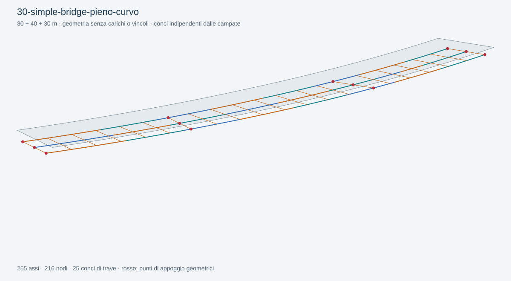

# 30 — Simple Bridge, traversi pieni, curva

Aggiornamento 26 ottobre 2026: questa definizione usa il [flusso modulare](../../docs/FLUSSO-MODULARE.md). Appoggi, travi, soletta, conci, diaframmi e mesh hanno componenti separati; gli input salvati sono stati conservati. I report precedenti descrivono la geometria di riferimento; il nuovo collaudo è raccolto nella [validazione del refactoring](../../docs/VALIDAZIONE-MODULARE-2026-10-26.md).

Aprire [30-simple-bridge-pieno-curvo.ghx](30-simple-bridge-pieno-curvo.ghx) con la nuova Release di BridGHe in Rhino 8.

Tracciato circolare di raggio 250 m e lunghezza d'arco 100 m. Le progressive degli appoggi sono 0, 30, 70 e 100 m, misurate sul tracciato. Le tre travi hanno offsets −4/0/+4 m; la soletta è larga 12 m e spessa 250 mm. Tutte le coordinate del file sono in mm.

Prove guidate:

1. Attivare `Labels` e osservare i traversi sulle due linee interne sghembe.
2. Sostituire la curva interna al parametro `Tracciato 3D` con una curva tangente-continua lunga 100000 mm; controllare l'orientamento sinistra/destra.
3. Ridurre `Chord Tolerance` per aumentare la risoluzione della geometria curva.
4. Leggere `Topology`: i punti di attacco degli appoggi sghembi possono avere progressive diverse fra le travi.
5. Verificare che il giunto aggiuntivo a 18 m divida il concio solo su G2.

I conci e i traversi sono indipendenti dal campionamento della curva. La soletta è una geometria di riferimento, non una mesh FEM. Non sono assegnate azioni o condizioni al contorno.

[Guida completa](../../docs/SIMPLE-BRIDGE.md) · [Report di soluzione e riapertura](validation.json).

## Soletta e link nel graticcio

La definizione aggiornata restituisce `Deck Beams`, `Deck Connections`, `Deck Strip Widths` e `Grillage Geometry`. Il passo della soletta è 2000 mm: 51 linee trasversali, 204 aste (due sbalzi e due campi per linea) e 153 collegamenti alle tre travi. L'asse della soletta è a metà spessore, quindi a −125 mm lungo la normale locale. Il componente `Bridge Rigid Links` è collegato alle eccentricità; non viene lanciata alcuna analisi.

Provare un passo di 3000 mm o una lista di `Slab Beam Stations` di Bridge Mesh Settings: le travi vengono spezzate alle nuove progressive mantenendo i conci. Con `Slab Axis Level = −100` di Bridge Slab Layout si spostano solo soletta a graticcio e attacchi superiori. `Grillage Geometry` richiede una proprietà esplicita per la famiglia 8; per la carpenteria di G1 usare `Bridge Geometry`. La mesh `Deck` resta una preview geometrica. Gli esempi 33–45 mantengono il proprio scopo e usano la carpenteria quando non è prevista la soletta FEM.
