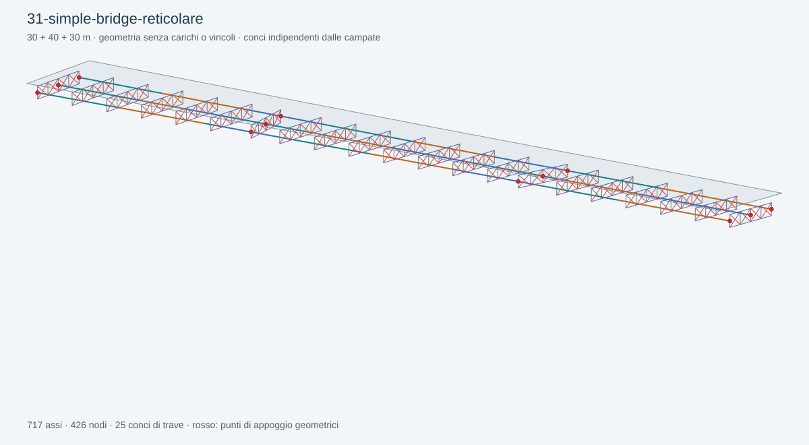

# 31 — Simple Bridge, traversi reticolari a X

Aprire [31-simple-bridge-reticolare.ghx](31-simple-bridge-reticolare.ghx) con la nuova Release di BridGHe in Rhino 8.

Ponte rettilineo a tre campate 30+40+30 m e tre travi a −4/0/+4 m. Reticoli alti 1500 mm, con due pannelli per baia fra travi adiacenti. Assi longitudinali a −1500 mm dalla linea all'estradosso della soletta; tutti gli input in mm.

Prove guidate:

1. Nel componente `Bridge Diaphragms`, lasciare `Pattern = 0` per X. Inizialmente `Connect X = false`: l'incrocio delle diagonali non è un nodo.
2. Impostare `Connect X = true`: ogni diagonale viene spezzata nel centro e le due diagonali condividono il nodo. Confrontare il conteggio di assi e nodi.
3. Impostare `Pattern = 1` per V: le diagonali convergono nel centro del corrente inferiore.
4. Impostare `Pattern = 2` per Warren: diagonali alternate senza montanti interni.
5. In `Diaphragm Members`, distinguere le famiglie 2 correnti superiori, 3 inferiori, 4 montanti, 5 diagonali.
6. Ridurre il passo oppure cambiare i conci: i montanti d'attacco rimangono collegati geometricamente agli assi delle travi.

I montanti non sono link rigidi impliciti. Non sono assegnati rilasci, sezioni, carichi o vincoli. Il reticolo deve ricevere successivamente le proprietà e le condizioni di connessione scelte.

[Guida completa](../../docs/SIMPLE-BRIDGE.md) · [Report di soluzione e riapertura](validation.json).
