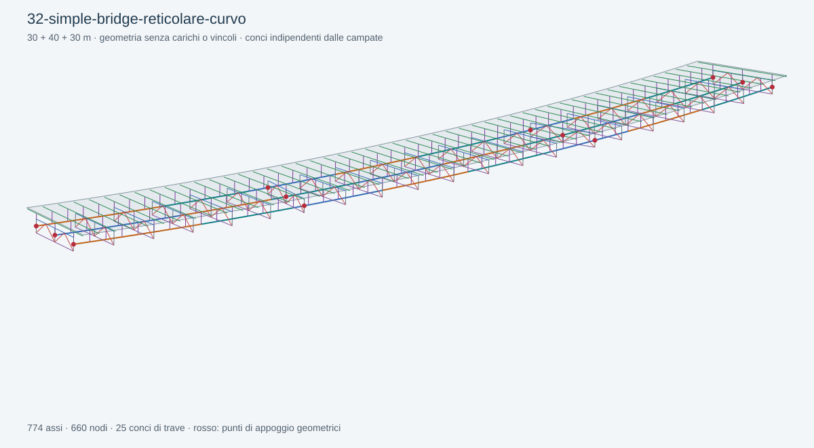

# 32 — Simple Bridge, traversi reticolari Warren, curva

Aprire [32-simple-bridge-reticolare-curvo.ghx](32-simple-bridge-reticolare-curvo.ghx) con la nuova Release di BridGHe in Rhino 8.

Tracciato circolare R=250 m, lunghezza 100 m, campate 30+40+30 m, tre travi. Reticoli Warren alti 1500 mm con due pannelli per baia. Pendenza trasversale variabile e sghembo sugli appoggi interni. Le quote e le progressive sono in mm.

Prove guidate:

1. Verificare l'orientamento dei traversi intermedi e di quelli sulle pile.
2. Nel parametro `Coppie progressiva / pendenza %`, modificare i valori ai 50 m e 100 m: la variazione viene interpolata lungo l'asse.
3. Cambiare `Pattern` da 2 a 0 o 1 per confrontare Warren, X e V sulla stessa geometria.
4. Assegnare `Girder Levels = -1500, -2000, -1500` per abbassare l'asse della trave centrale. Osservare l'andamento dei correnti e i montanti di connessione.
5. Provare un'altezza reticolare eccessiva: il componente segnala l'interferenza del corrente superiore con la soletta e cancella la precedente preview.

Gli appoggi di estremità sono trasversali. Per provare estremità sghembe occorre estendere il tracciato oltre le progressive delle spalle. Il generatore non estende né rifila automaticamente la soletta.

[Guida completa](../../docs/SIMPLE-BRIDGE.md) · [Report di soluzione e riapertura](validation.json).
