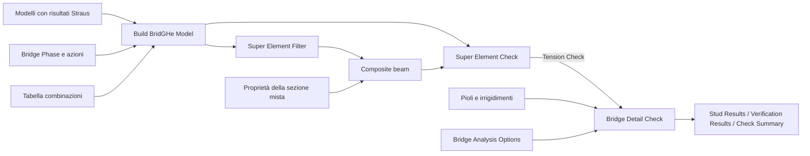

# 47 · Pioli e irrigidimenti: dal dettaglio al modello calcolato

Aggiornamento 26 ottobre 2026: questa definizione usa il [flusso modulare](../../docs/FLUSSO-MODULARE.md). Appoggi, travi, soletta, conci, diaframmi e mesh hanno componenti separati; gli input salvati sono stati conservati. I report precedenti descrivono la geometria di riferimento; il nuovo collaudo è raccolto nella [validazione del refactoring](../../docs/VALIDAZIONE-MODULARE-2026-10-26.md).

Due definizioni per imparare a impostare i dettagli e poi inserirli nel flusso del ponte:

- [47-pioli-irrigidimenti-verifiche.ghx](47-pioli-irrigidimenti-verifiche.ghx): geometria, azioni locali esplicite e quattro confronti numerici.
- [47-integrazione-modello.ghx](47-integrazione-modello.ghx): `Models + Phases → Build → Super Element Check → Bridge Detail Check`, con risultati Straus archiviati dell'esempio 19.
- [Guida Word, capitoli 29–31](../../docs/BridGHe_Guida_operativa.docx).
- Risultati effettivamente eseguiti: [verifica locale](validation.json), [integrazione al modello](validation-modello.json).

Non occorre una licenza Straus per aprire e ricalcolare questi file. Il primo usa azioni di esempio; il secondo riutilizza risultati nativi già calcolati e memorizzati nel GHX. Nessuno dei due esegue una nuova analisi globale.

## 1. Che cosa rappresentano i tre dettagli

**Pioli:** trasferiscono il flusso longitudinale tra soletta e trave. La loro domanda dipende dagli incrementi applicati quando la sezione lavora come mista e dalla disposizione dei connettori. La forza per piolo non coincide con il taglio verticale della trave.

**Irrigidimenti intermedi:** piatti trasversali saldati all'anima e alle flange. Nel calcolo GPC entrano la geometria dei piatti, le lunghezze dei pannelli adiacenti, la compressione dell'anima e l'eventuale compressione esterna assegnata. Il solo disegno di un piatto non basta a riconoscere il beneficio dei pannelli irrigiditi: i controlli di idoneità devono passare.

**Irrigidimenti d'appoggio:** ricevono anche la reazione compressiva dell'appoggio. Occorre assegnare `ReactionKN` e l'impronta effettiva, oltre a piatti, eccentricità e saldature. La reazione non è dedotta automaticamente dal taglio della singola sezione.

Le mesh di `Bridge Detail Layout` sono geometria di preview e quantità. Non aggiungono elementi o rigidezza al modello FEM, e non rappresentano tutti i cordoni, gli intagli o le interferenze di officina.

## 2. Aprire il primo file

Aprire il GHX con la Release corrente di BridGHe in Rhino 8. Il documento si calcola automaticamente. Leggere da sinistra a destra: definizioni comuni, incrementi di sezione, risultato finale e confronti B/C/D. I pannelli gialli collegati agli input sono modificabili.

Per vedere l'intero ponte attivare la preview del componente `Ponte 30+40+30 m`. La preview di `Layout G2 26-34 m` è attiva e mostra il dettaglio studiato. Il ponte ha tre travi con interasse 4 m e campate 30+40+30 m; il layout interessa soltanto G2 nell'intervallo **[26,34) m**, attorno alla pila a 30 m.

Questa geometria serve a localizzare il dettaglio. Le sollecitazioni della verifica locale **non sono state ricavate da quel ponte**: sono un benchmark riproducibile di taglio, con N=M=T=0 negli incrementi meccanici. Non dimostrano l'equilibrio o la verifica completa del ponte disegnato.

### Sezione, materiali e quote

| Dato | Valore del primo file |
|---|---:|
| Soletta, larghezza efficace × spessore | 2200 × 250 mm |
| Anima, altezza netta × spessore | 1330 × 16 mm |
| Ala superiore / inferiore | 450 × 30 / 600 × 40 mm |
| Acciaio strutturale | E=210000 MPa; fy=355 MPa; fu=510 MPa |
| Calcestruzzo | fck=30 MPa; modulo ricavato dalla classe GPC |
| Armatura longitudinale | Due file Ø16/150; asse a 40 mm dalle rispettive facce |
| Acciaio armature | E=200000 MPa; fy=450 MPa; fu=540 MPa |
| Quota asse trave / estradosso soletta | −1500 / 0 mm |
| Steel Top Offset | 1250 mm |

L'ala superiore si trova quindi a −250 mm. I pioli alti 180 mm terminano a −70 mm, con 70 mm fino all'estradosso. `Steel Top Offset` è una distanza geometrica dall'asse della trave alla faccia superiore dell'acciaio; non è calcolata dal baricentro. La larghezza efficace della soletta è un input di verifica, distinto dalla larghezza totale dell'impalcato.

### Definizioni comuni a verifica e preview

| Componente | Input principali |
|---|---|
| Bridge Studs | Enabled=True; CountPerRow=2; Diameter=22; Height=180; LongitudinalPitch=200; TransversePitch=150 mm |
| Bridge Studs, dettagli | Fu=450 MPa; GammaV=1.25; testa Ø35×10 mm; RequiredCover=40 mm; RepeatedActionDetail=True |
| Bridge Intermediate Stiffener | Layout=0 simmetrico; Width=200; Thickness=20; LeftPanel=RightPanel=2000 mm; EqualPanels=True |
| Intermedio, azioni e collegamenti | ExternalCompressionKN=100 kN; LoadX=0; LengthFactor=1; CheckWelds=True; WeldThroat=6 mm |
| Bridge Support Stiffener | Layout=0; Width=200; Thickness=25 mm; Location=0 appoggio interno; pannelli 2000 mm |
| Appoggio, azioni e collegamenti | ReactionKN=900 kN; LoadX=LoadZ=0; impronta 400×600 mm; LengthFactor=1; gola 10 mm; RigidEndPost=False |

`Width` è lo sbalzo **di ciascun piatto**, non la larghezza complessiva della coppia. Nel layout gli intermedi sono a 28 e 32 m; la coppia d'appoggio è a 30 m. Si ottengono **80 pioli, 4 piatti intermedi e 2 piatti d'appoggio**. Le lunghezze dei pannelli del layout sono tutte 2 m e coincidono con quelle assegnate ai verificatori.

La lista `Details` di Layout contiene tipi diversi, ordinati insieme a `IDs` e `Stations`. Non collegarla interamente all'ingresso `Details` di Section Check: quest'ultimo ammette una sola definizione per tipo. In questo esempio le definizioni originali sono condivise direttamente; per dettagli variabili occorre selezionare la definizione della zona/stazione corretta. Se si modificano le stazioni, aggiornare anche le lunghezze dei pannelli di verifica oppure usare le definizioni corrispondenti restituite dal layout.

## 3. Azioni e stato limite

`Bridge Section Increment` descrive incrementi **locali di sezione**, non le `Bridge Phase` del modello globale. I fili entrano in ordine cronologico in `Bridge Section Check`.

| Incremento | Kind | V [kN] | Phi | Ritiro [µε] |
|---|---|---:|---:|---:|
| 01 Acciaio | SteelOnly | 300 | 0 | 0 |
| 02 Misto lento | Composite | 200 | 2 | 0 |
| 03 Misto istantaneo | Composite | 800 | 0 | 0 |
| 04 Ritiro | Shrinkage | 0 | 2 | −200 |

Gli incrementi meccanici hanno N=M=T=0. Il ritiro genera le autotensioni primarie della sezione. `ShrinkageMicrostrain=-200` in questo componente equivale a `Strain=-0.0002` in `Bridge Shrinkage Action`: i due input hanno unità diverse.

Il taglio finale è 1300 kN. La fase acciaio non genera scorrimento nella connessione; il ritiro uniforme, nel tratto uniforme e senza flusso aggiuntivo, non genera qui un contributo longitudinale q. Gli effetti locali di estremità e quelli secondari da vincoli globali non sono rappresentati da questa ipotesi.

`Bridge Analysis Options` è impostato su `LimitState=0, Ultimate`; `Standard=Eurocode4` è il selettore del motore GPC. I coefficienti del benchmark sono GammaM0=1, GammaM1=1.1, GammaM2=1.25, GammaV=1.25; GammaC=1.5, GammaS=1.15, AlphaCC=0.85 e ShearEta=1.2. Sono dati di prova espliciti: **non costituiscono una selezione normativa per un progetto**. Il componente non applica coefficienti alle azioni e non genera combinazioni.

## 4. Pioli: lettura e controllo manuale

`Bridge Stud Results` riceve il risultato finale selezionato con `List Item`, indice 3. Restituisce q, PEd, PRd, qRd ed Eta; le ultime uscite separano i contributi di fase. Per questa sezione ad H, con una sola ala superiore:

```text
q totale = 0 + 103.484 + 507.653 + 0 = 611.137 N/mm = 611.137 kN/m
PEd = |q| × passo / numero pioli per fila / 1000     [kN]
qRd = numero pioli per fila × PRd × 1000 / passo    [N/mm]
Eta = PEd / PRd
```

La resistenza del singolo piolo restituita da GPC è 109.478 kN. In questo caso governa il ramo acciaio della formula implementata: `0.8 × 450 × π × 22² / 4 / 1.25 / 1000`. Il codice confronta anche il ramo calcestruzzo. Questo controllo manuale documenta l'implementazione; non sostituisce la verifica del campo di applicazione della norma al progetto.

| Scenario | Passo [mm] | q [N/mm] | PEd [kN] | PRd [kN] | qRd [N/mm] | Eta |
|---|---:|---:|---:|---:|---:|---:|
| A, base | 200 | 611.137 | 61.114 | 109.478 | 1094.782 | 0.558 |
| B, passo raddoppiato | 400 | 611.137 | 122.227 | 109.478 | 547.391 | 1.116 |

Il passo raddoppiato mantiene invariato il flusso elastico e la resistenza del singolo piolo, ma raddoppia la domanda e dimezza la resistenza per unità di lunghezza. A passa il controllo resistente del piolo; B non lo passa. Questo non implica che tutti gli altri controlli della connessione siano soddisfatti.

`RepeatedActionDetail=True` attiva criteri geometrici per azioni ripetute: **non è una verifica a fatica**. Nel file non sono attivate la resistenza a fatica né le verifiche di taglio longitudinale della soletta e dell'ancoraggio dell'armatura trasversale. L'armatura longitudinale della sezione non fornisce automaticamente quei dati.

## 5. Irrigidimenti: quali righe leggere

In `Bridge Verification Results` le uscite `Check`, `Demand`, `Resistance`, `Units`, `Ratio`, `Status` e `Notes` sono colonne della stessa tabella: l'indice i deve rimanere comune. `Ratio≤1` vale per quel controllo; `NaN` o `Da verificare` indicano un esito non disponibile, non un utilizzo nullo.

| Controllo GPC | A, base | Variante | Lettura |
|---|---:|---:|---|
| Intermedio · rigidezza torsionale | 0.96 | C: 5.75 | Il piatto da 8 mm non è idoneo |
| Intermedio · piatti entro classe 3 | 0.88 | C: 2.19 | Non basta superare la sola resistenza normale |
| Appoggio · saldature alle flange | 0.42 | D: 1.41 | La reazione maggiore rende critico il collegamento |
| Appoggio · contatto piatti/flangia | 0.32 | D: 1.07 | Anche il contatto supera il limite implementato |

C cambia soltanto lo spessore intermedio da 20 a 8 mm. GPC segnala l'irrigidimento non idoneo ed esclude il beneficio dei pannelli irrigiditi nella resistenza a taglio. D cambia soltanto `ReactionKN` da 900 a 3000 kN; il flusso nei pioli resta invariato.

Le larghezze dei piatti vanno anche confrontate con l'ingombro disponibile: qui `(450−16)/2=217 mm`, contro uno sbalzo di 200 mm. L'impronta trasversale assegnata è 600 mm; la coppia richiede 416 mm. Il modello locale assume piatti continui, senza intagli, con vincolo laterale alle flange. Non comprende la flessione della piastra di ripartizione o il progetto dell'apparecchio d'appoggio.

I confronti B/C/D sono ricalcoli con `Bridge Detail Check`; non modificano la preview A. Per vedere un dettaglio alternativo, collegare la sua definizione anche a Layout. L'esito `Non verificato` resta una riga del risultato e non rende necessariamente rosso il componente: rosso indica un errore di input/calcolo.

Il ritiro produce anche trazione nel calcestruzzo del modello non fessurato: il relativo warning resta visibile. La fessurazione e la scelta della sezione efficace/fessurata richiedono una valutazione specifica; l'esempio non le dichiara risolte.

## 6. Collegarlo al modello calcolato o al superelemento

Aprire **47-integrazione-modello.ghx**. Contiene i campioni nativi archiviati di G2, beam 36, tra x=27.5 e 30 m del ponte dell'esempio 19 REV003. La sezione di quel file è diversa dal benchmark A: H2000 con soletta efficace 3000×250 mm e rapporti n0=7, n∞=18, nritiro=12. I valori del paragrafo 4 non vanno confrontati con questo secondo file.



1. Premere **Run su Build BridGHe Model**, poi **Run su Super Element Check**. I componenti a valle si aggiornano automaticamente. Ripetere i Run dopo modifiche alle fasi o alle combinazioni.
2. Nel proprio flusso, collegare l'uscita di Build sia a `Super Element Filter` sia a `BridGHe Model` di Super Element Check. Il `Composite beam` deve derivare dalle aste del modello assemblato, con i risultati, e ricevere la proprietà fisica mista.
3. Collegare **Tension Check**, prima uscita di Super Element Check, a **Section result** di Bridge Detail Check. Non collegare `Tau b`, che attualmente restituisce NaN, né soltanto la lista delle forze.
4. Collegare `Bridge Studs` a Studs, `Bridge Intermediate Stiffener` a Intermediate stiffener, `Bridge Support Stiffener` a Support stiffener. La geometria della sezione e le azioni vengono già dal risultato sorgente: non reinserirle in un altro Section Check.
5. Conservare l'albero **{indice beam; indice stazione}**, con le combinazioni come item. Dettagli e reazioni variabili richiedono una corrispondenza esplicita con questa struttura; non usare Flatten indiscriminatamente.

Le etichette del `Bridge Check Summary` sono automatiche: collegare soltanto Results e lasciare Labels vuoto. Super Element Check associa a ogni risultato superelemento, Beam ID, distanza dall'inizio dell'asta e combinazione; Detail Check conserva questi riferimenti. Per il beam 36 le cinque stazioni locali vanno da `s=0` a `s=2500 mm`, corrispondenti alle coordinate globali X=27.5–30 m di questo ponte rettilineo. Dopo modifiche alle stazioni o alle combinazioni, ricalcolare il checker: non occorre più aggiornare un elenco manuale. Labels serve soltanto per eventuali nomi personalizzati.

Il file dimostra anche il passaggio da SLE rara, attualmente usato da Super Element Check, a `Ultimate` esplicito nel Detail Check. La tabella si chiama DEMO e usa fattori unitari: **Ultimate seleziona i controlli ma non rende normativa la combinazione, non maggiora i carichi e non cambia le azioni di fase**. Per una verifica SLU effettiva inserire le combinazioni corrette a monte e selezionare i risultati pertinenti. R=900 kN è un input didattico indipendente: non è la reazione del ponte estratta da Straus.

`Bridge Bearing Envelope` può aiutare a leggere reazioni dai modelli analizzati: verificare componente, assi, segno, caso/combinazione e unità. In N–mm, la reazione FEM è in N e `ReactionKN` è in kN. L'associazione della reazione con la verifica locale non avviene automaticamente in questo esempio. L'attuale oggetto GPC tratta R come inviluppo assegnato, costante lungo la storia del singolo calcolo.

**Limite del metodo:** usare `Calculation=0, Cumulative`. Il percorso `LinearHistory` conserva uno storico N–Mx diverso e non implementa taglio, pioli e irrigidimenti; Detail Check lo rifiuta esplicitamente. Non cambiarlo in Cumulative soltanto per far sparire l'errore: va scelta consapevolmente l'ipotesi di calcolo. Anche l'adattatore dei superelementi ha un campo limitato a una H simmetrica con soletta e azioni N–Mx–Vy: torsione e flessione deviata richiedono un verificatore diverso.

## 7. Grafici di pioli e irrigiditori

Il file [47-integrazione-modello.ghx](47-integrazione-modello.ghx) include tre plot, ciascuno collegato a un **Bridge Plot Preview**:

1. **Pioli:** PEd e PRd in kN/piolo lungo l'estratto di trave. Quantity 5 confronta le due curve; 4 mostra il rapporto con riferimento WR=1; 6 confronta il flusso e la resistenza per lunghezza.
2. **Intermedio:** inviluppo dei WR delle voci GPC alla progressiva locale `s=0 m` (X globale 27.5 m).
3. **Appoggio:** inviluppo dei WR alla progressiva locale `s=2.5 m` (pila a X globale 30 m).

Le due posizioni sono assegnate per il tutorial. Geometria, pannelli da 2 m e reazione da 900 kN rimangono gli input locali dimostrativi descritti sopra; il grafico non identifica automaticamente gli irrigiditori fisici o la reazione nel modello. Nel progetto reale associare a ogni posizione il suo dettaglio, i pannelli effettivi e le azioni pertinenti.

La **Value List** di ogni irrigiditore seleziona l'inviluppo o una voce singola. Per quest'ultima, `Display` sceglie **0 WR**, **1 domanda**, **2 resistenza/limite**, **3 confronto**. L'inviluppo usa sempre WR. **Governing checks** identifica la voce governante, comprese le parità; **Unavailable checks** espone gli esiti mancanti. Un controllo senza WR non diventa zero: l'inviluppo in quella posizione/combinazione è incompleto. Per i controlli qualitativi il WR può essere convenzionale, non una misura della riserva resistente.

Le progressive sono in **metri dalla prima asta di Super-Element Beam**, non coordinate globali. I risultati devono essere presenti esattamente alle posizioni richieste, entro `1e-6 m`. Nessuna interpolazione tra irrigiditori. I controlli d'appoggio comprendono terminale e seconda coppia solo quando attivati nel verificatore.

Per vedere subito i risultati, aprire [47-anteprima-grafici.ghx](47-anteprima-grafici.ghx): contiene snapshot dei tre SVG e una Value List per scegliere il grafico. Questo file visualizza i risultati salvati; per ricalcolarli usare il file integrato. Gli stessi grafici sono esportati in [grafici/](grafici/), in SVG. Per ottenere un PNG assegnare un percorso con estensione `.png` al plot. Doppio clic sulla preview per ingrandire.

La combinazione resta **DEMO**: questi diagrammi illustrano il funzionamento e non costituiscono la verifica completa del ponte. [Guida dei plot](../../docs/GRAFICI.md#pioli-e-irrigiditori-domanda-resistenza-e-wr).

## 8. Riproduzione e controlli

```powershell
dotnet build tests/BridGHe.Smoke -c Release
# Rigenera il benchmark locale, lo salva e lo riapre
dotnet run --project tests/BridGHe.Smoke -c Release --no-build -- --bridge-details-example
# Ricalcola il file integrato già distribuito, senza gli archivi esterni
dotnet run --project tests/BridGHe.Smoke -c Release --no-build -- --regression bridge-details-model-example
# Rigenera il file integrato: richiede i risultati REV003-* già presenti nei calcoli dell'esempio 19
dotnet run --project tests/BridGHe.Smoke -c Release --no-build -- --bridge-details-model-example
```

Il benchmark controlla bilancio dei contributi, conversione N→kN, resistenza acciaio del piolo con formula indipendente, sensibilità al passo, esiti dei piatti sottili e della reazione elevata, conservazione delle tensioni normali nei confronti, quantità/quote/mesh della preview e persistenza del documento. Il file integrato controlla conservazione dei percorsi dell'albero, azioni e strain di fase, risultati per tutte le stazioni e riapertura. I report JSON distinguono questi controlli da una nuova analisi Straus (`solverInvoked=false`).

Le spiegazioni e formule qui riportate documentano i sorgenti locali GPC (`HBridgeSection.Shear.cs`, `HBridgeSection.Details.cs`, `BridgeShearConnection.cs`) e gli adattatori BridGHe. I riferimenti normativi nelle note dei risultati sono quelli della libreria: questo tutorial non certifica aggiornamento, applicabilità o completezza normativa delle verifiche.
